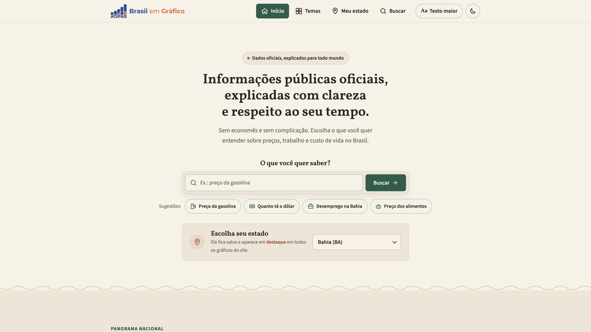
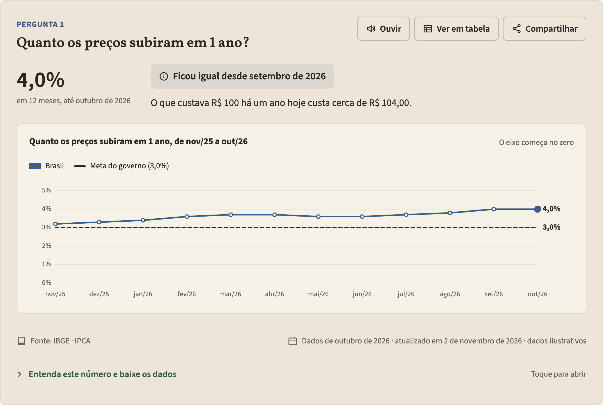
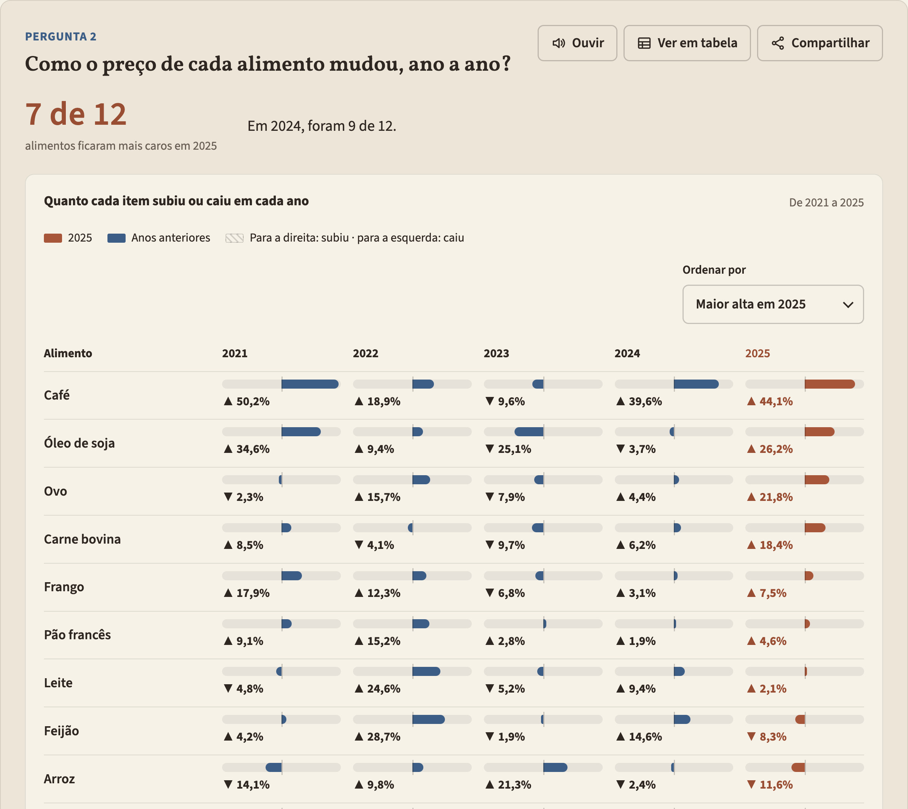
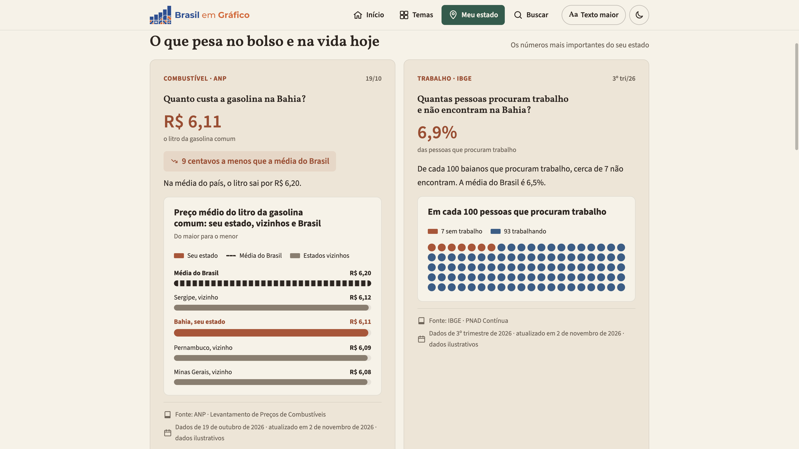
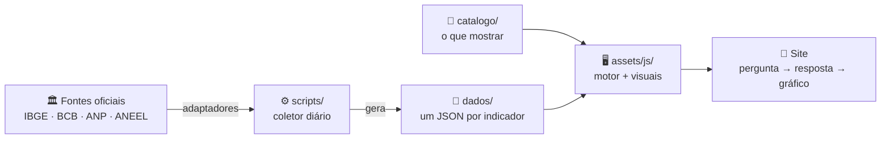
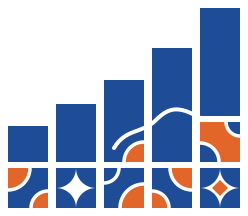

<div align="center">

<picture>
  <source media="(prefers-color-scheme: dark)" srcset="assets/img/logo-horizontal-escuro.svg">
  
</picture>

### Dados públicos oficiais, explicados com clareza e respeito ao seu tempo.

Sem economês e sem complicação: cada número do Brasil vira uma pergunta simples,<br>uma resposta direta e um gráfico honesto.

<br>

[](LICENSE)
[](CONTRIBUTING.md)
[](#-acessível-de-verdade)
[](#-como-funciona)
[](#-fontes-oficiais)

[**🌐 Acessar o site**](https://brasilemgrafico.com.br) · [**Como contribuir**](CONTRIBUTING.md) · [**Adicionar um dado**](docs/como-adicionar-dados.md) · [**Arquitetura**](docs/arquitetura.md) · [**Abrir uma issue**](https://github.com/andersonvalentim/brasil-em-grafico/issues/new)

<br>



</div>

---

## 🎯 Objetivo

Os dados públicos do Brasil existem, são abertos e são de qualidade. Mas, para a maioria das pessoas, eles estão escondidos atrás de siglas, tabelas enormes e gráficos difíceis de ler.

O **Brasil em Gráfico** quer que **qualquer pessoa**, inclusive quem nunca leu um gráfico, consiga responder em poucos segundos perguntas como:

> 💬 *Quanto os preços subiram em 1 ano?*
> 💬 *Quanto custa a gasolina no meu estado, comparado com o resto do país?*
> 💬 *O preço do arroz subiu ou caiu este ano?*
> 💬 *De cada 100 pessoas que procuram trabalho, quantas não encontram?*

É um projeto **gratuito, apartidário e aberto**, construído para receber contribuições: cada novo dado ou gráfico é um arquivo pequeno, sem precisar mexer no resto do site.

## ✨ O que torna o projeto diferente

<table>
<tr>
<td width="33%" valign="top">

#### 🗣️ Pergunta antes do gráfico
Todo cartão segue a mesma ordem: **pergunta → número grande → frase → gráfico → detalhes**. Quem aprende a ler um cartão entende o site inteiro.

</td>
<td width="33%" valign="top">

#### 📏 Gráficos honestos
Nada de pizza, 3D ou eixo cortado para exagerar uma mudança. No máximo 3 cores, e a cor nunca diz se algo é bom ou ruim: quem diz é o texto.

</td>
<td width="33%" valign="top">

#### 📍 O seu estado em destaque
Escolha seu estado uma vez e ele aparece destacado em todos os gráficos, comparado com a média do Brasil e com os vizinhos.

</td>
</tr>
<tr>
<td valign="top">

#### ♿ Acessível de verdade
Botão **Ouvir** em cada gráfico, **tabela equivalente**, texto maior, modo escuro, teclado e zoom de 200%.

</td>
<td valign="top">

#### 🔄 Atualização automática
Os números vêm direto das bases oficiais, por uma rotina diária. Se uma fonte cair, o site mantém o último número que conseguiu buscar.

</td>
<td valign="top">

#### 🧩 Modular
Indicadores, temas e tipos de gráfico são peças independentes. Adicionar um dado novo é escrever um JSON, sem mexer no HTML.

</td>
</tr>
</table>

## 🖼️ Veja como fica

<table>
<tr>
<td width="50%" valign="top">

**Como algo mudou com o tempo**


</td>
<td width="50%" valign="top">

**Comparar ano a ano, item por item**


</td>
</tr>
<tr>
<td colspan="2">

**A página do seu estado**


</td>
</tr>
</table>

> [!NOTE]
> Os números vêm direto das fontes oficiais e são atualizados todo dia por uma automação. Se uma fonte ficar fora do ar, o site mantém o último número que conseguiu buscar.

## 📊 O que já está no site

| Tema | Pergunta principal | Fonte |
|---|---|---|
| 📈 **Preços** | Quanto os preços subiram em 1 ano e em cada ano? Em que parte do orçamento subiram mais? | IBGE · IPCA |
| 🛒 **Comida** | Como o preço de cada alimento mudou, ano a ano? Quanto ficou mais caro comer fora? | IBGE · IPCA |
| 🏠 **Casa e contas** | Quanto subiram luz, aluguel, condomínio, água, gás, internet e celular? | IBGE · IPCA |
| ⛽ **Combustíveis e transporte** | Quanto custa o litro da gasolina no meu estado? Quanto subiram ônibus, aplicativo e passagem aérea? | ANP · IBGE |
| 🩺 **Saúde e educação** | Quanto subiram plano de saúde, remédios, escola e faculdade? | IBGE · IPCA |
| 👷 **Trabalho** | Quantas pessoas procuram trabalho e não encontram? | IBGE · PNAD Contínua |
| 💵 **Juros e dólar** | Quanto vale 1 dólar hoje? Qual é a taxa de juros básica? | Banco Central |
| 💡 **Energia** | Qual é a bandeira da conta de luz este mês? | ANEEL |
| 👥 **População** | Quantas pessoas vivem em cada estado? | IBGE |

**Quer ver outro assunto aqui?** Segurança, renda, meio ambiente… [Sugira um tema](https://github.com/andersonvalentim/brasil-em-grafico/issues/new) ou [adicione você mesmo](docs/como-adicionar-dados.md).

## 🧠 Como funciona

O site é dividido em quatro camadas que não dependem umas das outras:



| Pasta | O que tem | Quem edita |
|---|---|---|
| `catalogo/` | Indicadores, temas e páginas, em JSON | **Pessoas** (a maioria das contribuições é aqui) |
| `dados/` | Os números, um arquivo por indicador | O coletor (gerado automaticamente) |
| `assets/js/visuais/` | Os tipos de gráfico | Quem programa |
| `scripts/` | O coletor e os adaptadores de cada fonte | Quem programa |
| `docs/` | Contratos e guias | Todo mundo |

## 🤝 Contribua em 5 passos

Adicionar um dado novo, como o **preço do aluguel**, não exige mexer no HTML:

```bash
# 1. Cadastre o indicador (ele nasce como rascunho e não aparece no site ainda)
npm run novo-indicador -- --id ipca-aluguel --tema precos --adaptador ibge-sidra --nome "Quanto o aluguel subiu em 1 ano"

# 2. Diga de onde ele vem: edite fonte.parametros em catalogo/indicadores/ipca-aluguel.json

# 3. Colete e confira os números
npm run dados -- --so ipca-aluguel
npm run validar
```

```jsonc
// 4. Escolha como mostrar: acrescente um cartão em catalogo/temas/precos.json
{
  "indicador": "ipca-aluguel",
  "visual": "ranking-uf",
  "pergunta": "Onde o aluguel subiu mais?"
}
```

**5.** Mude o indicador para `"status": "ativo"` e abra um pull request. Pronto! 🎉

<details>
<summary><b>📐 Tipos de gráfico disponíveis</b></summary>
<br>

| Visual | Mostra | Bom para |
|---|---|---|
| `numero` | Só o número grande | Qualquer dado |
| `linha` | Como mudou com o tempo | Séries mensais, trimestrais, diárias |
| `ranking-uf` | Os 27 estados do maior para o menor | Comparar estados |
| `comparativo-local` | Seu estado × Brasil × vizinhos | Dado por estado |
| `histograma` | Quantos estados há em cada faixa | Ver a distribuição |
| `pictograma` | "Em cada 100 pessoas…" | Porcentagens |
| `ano-a-ano` | Cada item numa linha, cada ano numa coluna | Comparar itens ao longo dos anos |
| `anual` | Quanto mudou de um ano para o outro | Inflação ano a ano, com o seu estado ao lado do Brasil |
| `destaques-categorias` | O que mais subiu e o que mais caiu | Dados com categorias |
| `bandeira` | Bandeira tarifária do mês | Específico da ANEEL |

Não achou o gráfico que precisa? Crie um novo em `assets/js/visuais/<nome>.js` (veja o [guia](docs/como-adicionar-dados.md#criar-um-tipo-de-gráfico-novo)).

</details>

<details>
<summary><b>🧭 Que tipo de contribuição é bem-vinda?</b></summary>
<br>

| Quero… | Onde mexer | Precisa programar? |
|---|---|---|
| Adicionar um indicador | `catalogo/indicadores/` + um cartão no tema | Não |
| Criar um tema novo | `catalogo/temas/` + `catalogo/site.json` | Não |
| Melhorar um texto ou uma pergunta | Os JSON de `catalogo/` | Não |
| Relatar uma barreira de acessibilidade | [Abrir uma issue](https://github.com/andersonvalentim/brasil-em-grafico/issues/new) | Não |
| Criar um tipo de gráfico | `assets/js/visuais/` | Sim (JavaScript) |
| Conectar uma fonte oficial nova | `scripts/adaptadores/` | Sim (Node.js) |

</details>

Leia o **[CONTRIBUTING.md](CONTRIBUTING.md)** para o fluxo completo e as regras de estilo dos gráficos.

## 💻 Rodar no seu computador

Você só precisa do [Node.js 18+](https://nodejs.org).

```bash
git clone https://github.com/andersonvalentim/brasil-em-grafico.git
cd brasil-em-grafico

npm run dev        # abre o site em http://127.0.0.1:8642
npm run dados      # busca os números nas fontes oficiais
npm run validar    # confere se o catálogo está consistente
```

## 🏛️ Fontes oficiais

| Órgão | O que mede | Atualização |
|---|---|---|
| [IBGE](https://sidra.ibge.gov.br) | Inflação (IPCA), desemprego (PNAD Contínua), população | Mensal / trimestral / anual |
| [Banco Central do Brasil](https://www3.bcb.gov.br/sgspub) | Dólar, taxa Selic | Diária |
| [ANP](https://www.gov.br/anp) | Preço dos combustíveis por estado | Semanal |
| [ANEEL](https://dadosabertos.aneel.gov.br) | Bandeiras tarifárias da conta de luz | Mensal |

Os dados pertencem às suas fontes. O Brasil em Gráfico apenas os organiza e explica.

## 🗺️ Próximos passos

- [x] Site estático, acessível e com modo escuro
- [x] Catálogo modular de indicadores, temas e visuais
- [x] Guia de contribuição e validação automática
- [x] Conectores oficiais (IBGE SIDRA, BCB SGS, ANP, ANEEL) com atualização diária
- [x] Publicação do site em [brasilemgrafico.com.br](https://brasilemgrafico.com.br)
- [x] Temas de comida, casa e contas, transporte, saúde e educação
- [ ] Novos temas: segurança, renda, meio ambiente
- [ ] Mapa do Brasil como tipo de gráfico

## ♿ Acessível de verdade

- Segue as regras **WCAG 2.2, nível AA**.
- Todo gráfico tem um botão **Ouvir**, que lê a resposta em voz alta, e um botão **Ver em tabela**.
- **Aa Texto maior** aumenta as letras, e o site funciona com zoom de 200%.
- Tudo funciona pelo **teclado**, com o foco sempre visível.
- Leve: funciona em celulares simples e com internet fraca.

Encontrou alguma barreira? [Conte para a gente](https://github.com/andersonvalentim/brasil-em-grafico/issues/new).

---

<div align="center">



**Brasil em Gráfico** · Feito em código aberto, para todo mundo entender o Brasil.

Licença [MIT](LICENSE) · Dados de acesso público

</div>
